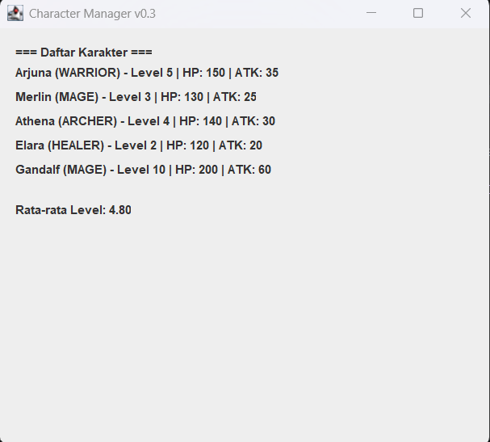
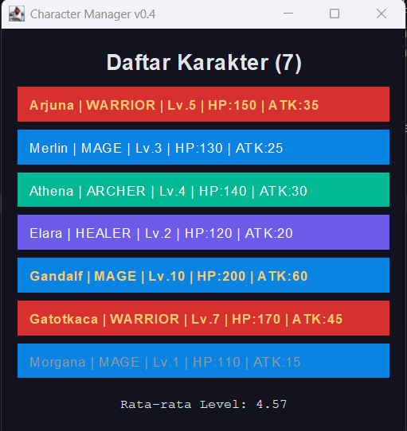

# Character Manager — TP10 (Java Visual SIH-6406)

Pada sprint ini `MainWindow` naik dari v0.3 ke v0.4. Ditambahkan class `AppTheme`
(package `view`) yang menjadi pusat warna, font, dan border, sehingga daftar karakter
tampil sebagai kartu berwarna menurut role. Package `model` tidak berubah sama sekali.

## Screenshot sebelum (v0.3) dan sesudah (v0.4)

Sebelum (v0.3):



Sesudah (v0.4):



## Mengapa warna disimpan di `AppTheme`, bukan di `Character`

Warna adalah urusan tampilan, bukan data karakter, sehingga pemetaannya saya letakkan di
`AppTheme.colorFor(CharacterType)` pada package `view`. Jika `Character` menyimpan
`java.awt.Color`, class Model akan bergantung pada library GUI sehingga tidak bisa dipakai
di aplikasi konsol atau unit test tanpa GUI, dan sulit dimigrasi ke JavaFX yang punya class
`Color` sendiri. Dengan rancangan ini arah ketergantungan hanya satu arah (View mengenal
Model lewat enum, Model tidak mengenal View), dan mengganti tema cukup dengan mengedit
`AppTheme.java`. Bukti Model tidak berubah ada di bagian "Bukti `git diff`" di bawah.

## Mini-Challenge: highlight level tinggi

Karakter dengan level ≥ 5 tampil dengan teks emas dan tebal. Batasnya disimpan sebagai
konstanta bernama `HIGH_LEVEL_THRESHOLD = 5` di `AppTheme`, bukan angka tertulis di dalam
`if`. Saya menaruhnya di View karena "level tinggi" di sini hanya aturan tampilan (kapan
sebuah kartu disorot), bukan aturan permainan, dan Model memang tidak boleh diubah.

## Dua properti tambahan

| Properti | Penerapan | Alasan |
|---|---|---|
| Tooltip berisi detail HP/ATK | `setToolTipText(describe(role) + " \| HP .., ATK ..")` | Detail statistik tersedia saat kursor diam di kartu tanpa membuat teks kartu terlalu panjang |
| `setEnabled(false)` untuk karakter level 1 | Kartu Morgana tampil redup | Menandai karakter yang belum siap tanpa menyembunyikannya, sehingga pengguna tetap tahu karakternya ada |

Batas level 1 juga disimpan sebagai konstanta bernama (`DISABLED_LEVEL`).

## Bukti `git diff`: package `model` tidak berubah

```
git diff ee72bed~1 HEAD --stat -- CharacterManager/src/com/unpri/charactermanager/model
```

Output perintah di atas kosong, artinya tidak ada perubahan di `Character.java`,
`CharacterType.java`, maupun `CharacterManager.java`.

## Struktur folder

```
javavisual-tp03-253303621276/
├── README.md
├── .gitignore
├── screenshots/
│   ├── tp10-sebelum-v03.png
│   └── tp10-sesudah-v04.png
└── CharacterManager/
    └── src/
        ├── Main.java
        └── com/unpri/charactermanager/
            ├── model/
            │   ├── CharacterType.java
            │   ├── Character.java
            │   └── CharacterManager.java
            └── view/
                ├── AppTheme.java
                └── MainWindow.java
```

## Identitas

- Nama: Imanuel Christ P Simatupang
- NIM: 253303621276
- Analisis Bagian D (Google Docs): https://docs.google.com/document/d/1iFcH3bTUDjLM2RNOV8unzBVll7e17SdCR_CFz5f4g7A/edit?usp=sharing
