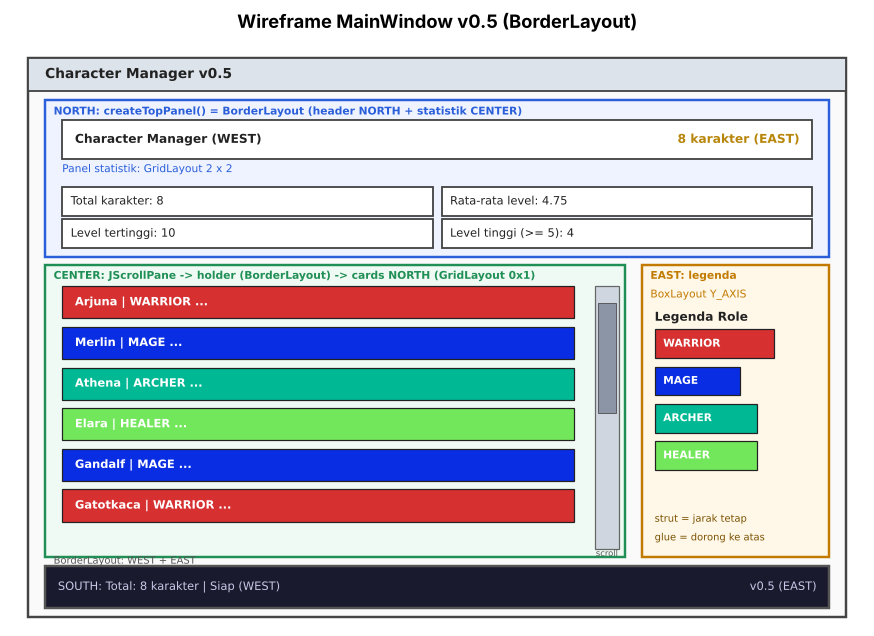
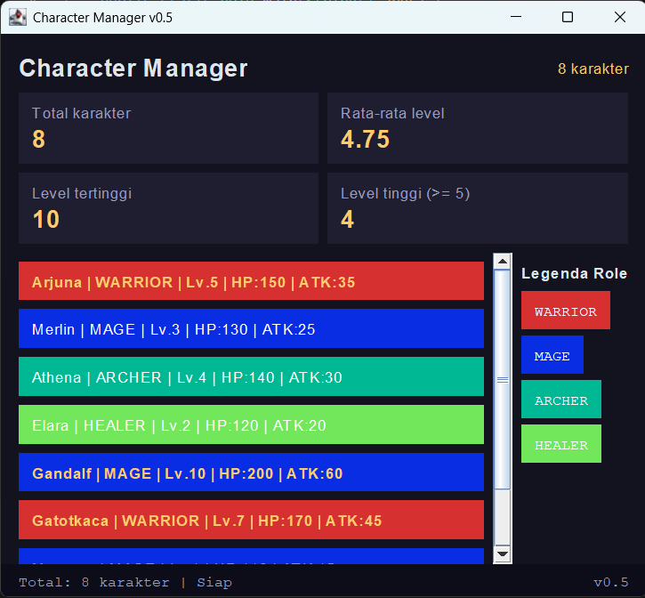
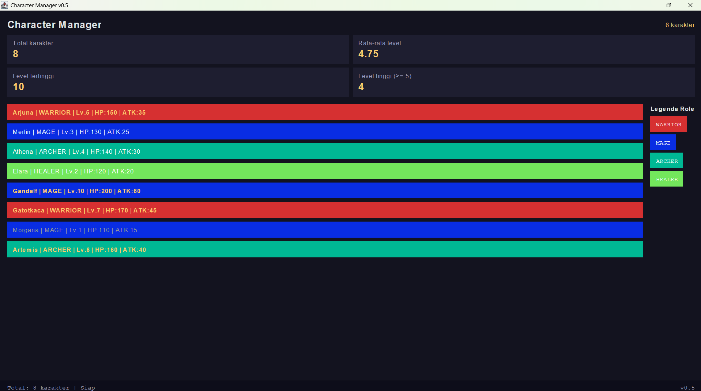
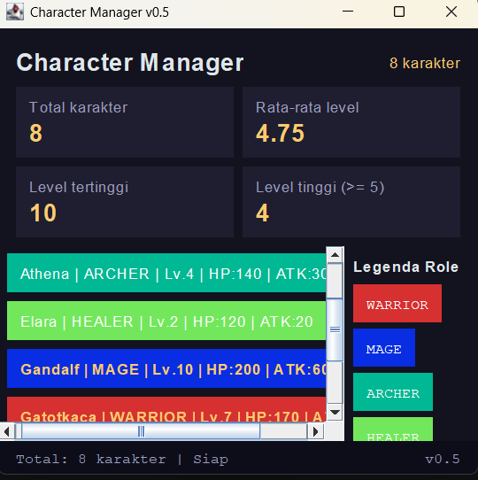

# Character Manager — TP12 (Java Visual SIH-6406)

Pada sprint ini `MainWindow` naik dari v0.4 ke v0.5 dengan tata letak `BorderLayout` yang
tetap rapi saat jendela diubah ukurannya. Empat wilayah terisi: header dan panel statistik
(NORTH), daftar karakter berscroll (CENTER), legenda role (EAST), dan bar status (SOUTH).
Package `model` tidak berubah sama sekali.

## Wireframe



## Screenshot

Ukuran awal:



Jendela dilebarkan:



Jendela dikecilkan sampai scrollbar tampak:



## Tabel pengamatan resize (prediksi vs hasil)

| Aksi | Prediksi (berdasarkan aturan BorderLayout) | Hasil pengamatan |
|---|---|---|
| Jendela dilebarkan | Hanya wilayah CENTER yang ikut melebar. Legenda (EAST) tetap selebar isinya, sedangkan header dan bar status memanjang mengikuti lebar jendela. | Jendela dapat ditarik melebar ke kanan dan ke kiri, serta dapat di-maximize. Daftar kartu di tengah ikut melebar mengisi ruang tambahan, sementara legenda tetap berukuran sama dan header serta bar status memanjang. Hasilnya sesuai prediksi. |
| Jendela ditinggikan | Wilayah CENTER bertambah tinggi. Kartu tidak melar karena grid kartu berada di NORTH panel `holder`, dan legenda tetap menempel di atas. | Jendela dapat ditarik ke atas dan ke bawah. Area daftar bertambah tinggi, kartu tetap pada tinggi alaminya dengan ruang kosong di bawahnya, dan legenda tetap di bagian atas. Hasilnya sesuai prediksi. |
| Tinggi dikecilkan | Scrollbar muncul atau bertambah panjang di area daftar, sedangkan header dan bar status tetap terlihat. | Ketika tinggi dikecilkan, daftar karakter dapat digeser naik-turun dengan scrollbar sehingga seluruh karakter tetap bisa dilihat, dan header serta bar status tetap tampil. Hasilnya sesuai prediksi. |
| Disempitkan sampai batas | Jendela berhenti mengecil pada ukuran 560 x 380 karena `setMinimumSize`. | Jendela berhenti mengecil pada ukuran minimum dan tidak bisa diperkecil lagi, sehingga tampilan tidak terpotong. Hasilnya sesuai prediksi. |

Kesimpulannya, tata letak `BorderLayout` bekerja sesuai rancangan: hanya CENTER yang menyerap
perubahan ukuran, area lain mempertahankan ukurannya, dan `JScrollPane` menjaga seluruh
karakter tetap dapat diakses ketika ruang tidak cukup.

## Struktur panel bersarang

`MainWindow` memakai `BorderLayout` dengan empat wilayah, dan setiap wilayah berisi panel
yang tersusun bersarang. NORTH berisi panel pembungkus `top` yang memuat header (judul di
kiri, jumlah karakter di kanan) dan panel statistik `GridLayout` 2x2. CENTER berisi
`JScrollPane` yang membungkus panel `holder`, dan di NORTH `holder` ada panel `cards` ber-
`GridLayout` yang menampung kartu karakter. EAST berisi legenda `BoxLayout` vertikal yang
diturunkan dari `CharacterType.values()`, dan SOUTH berisi bar status dengan teks di kiri
dan versi di kanan.

```
MainWindow (JFrame, BorderLayout)
├── NORTH  : top (JPanel, BorderLayout)
│   ├── NORTH  : header (BorderLayout)  judul WEST, jumlah EAST
│   └── CENTER : stats (GridLayout 2x2) empat sel statistik
├── CENTER : JScrollPane
│   └── holder (BorderLayout)
│       └── NORTH : cards (GridLayout 0x1) -> kartu JLabel
├── EAST   : legend (BoxLayout Y_AXIS) -> strut, chip per role, glue
└── SOUTH  : status (BorderLayout)  teks WEST, versi EAST
```

## Panel tambahan: statistik `GridLayout` 2x2

Panel statistik (total karakter, rata-rata level, level tertinggi, jumlah karakter level
tinggi) saya taruh di bawah header. Saya memilih `GridLayout` 2x2 karena keempat statistik
setara dan sebaiknya berukuran seragam, serta tetap tersusun dua kolom saat jendela
dilebarkan. Layout yang saya tolak:

- `FlowLayout`: sel berukuran sesuai isi (tidak seragam), dan bisa pindah baris sendiri
  ketika jendela menyempit sehingga susunan 2x2 tidak stabil.
- `BoxLayout`: hanya menyusun pada satu sumbu, sehingga 2x2 membutuhkan panel bersarang
  tambahan.
- `GridBagLayout`: terlalu rumit untuk empat sel yang ukurannya sama.

Bar status awalnya memakai `FlowLayout`, lalu saya ganti ke `BorderLayout` agar teks status
menempel kiri dan versi menempel kanan, karena `FlowLayout` tidak bisa menempelkan elemen
ke sisi kanan.

Catatan: statistik dihitung di `MainWindow` dari list yang diterima. Idealnya perhitungan
seperti itu berada di Model atau Controller, dan ini saya catat sebagai perbaikan untuk
sprint berikutnya.

## Bukti `git diff`: package `model` tidak berubah

```
git diff 42d3a60 HEAD --stat -- CharacterManager/src/com/unpri/charactermanager/model
```

Output perintah di atas kosong, artinya tidak ada perubahan di `Character.java`,
`CharacterType.java`, maupun `CharacterManager.java`.

## Struktur folder

```
javavisual-tp03-253303621276/
├── README.md
├── .gitignore
├── screenshots/
│   ├── tp12-wireframe.png
│   ├── tp12-awal.png
│   ├── tp12-lebar.png
│   └── tp12-kecil.png
└── CharacterManager/
    └── src/
        ├── Main.java
        └── com/unpri/charactermanager/
            ├── model/
            │   ├── CharacterType.java
            │   ├── Character.java
            │   └── CharacterManager.java
            └── view/
                ├── AppTheme.java
                └── MainWindow.java
```

## Identitas

- Nama: Imanuel Christ P Simatupang
- NIM: 253303621276
- Analisis Bagian D (Google Docs): https://docs.google.com/document/d/1np48Nh2uRFnJ3t-yYX4MizTj7w2-TRCpdJNKdamaFlk/edit?usp=sharing
