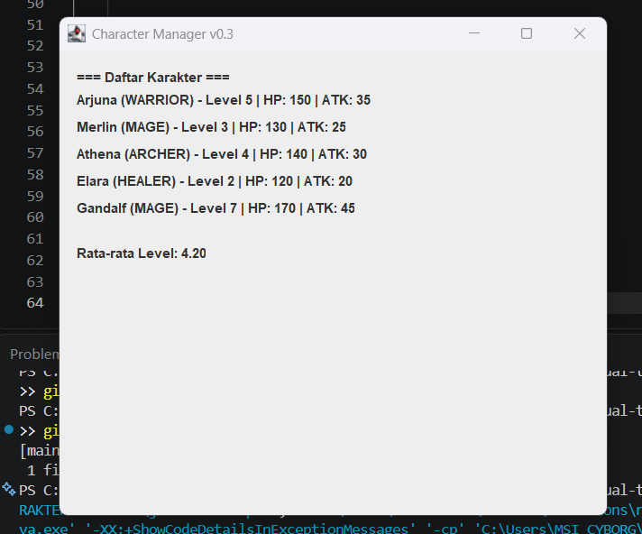

# Character Manager — TP8 (Java Visual SIH-6406)

Pada sprint ini aplikasi berpindah dari console ke GUI. Ditambahkan class
`MainWindow` (package `view`, `extends JFrame`) yang menampilkan daftar karakter
secara dinamis lewat loop, ditambah statistik "Rata-rata Level" di bawah daftar.
`Main.java` menjalankan jendela lewat `SwingUtilities.invokeLater()`.

## Screenshot MainWindow

Sebelum data diubah (Gandalf level 7, rata-rata level 4.20):



Sesudah data diubah (Gandalf level 10, rata-rata level 4.80):


Kedua screenshot memuat 5 karakter dan membuktikan bahwa statistik ikut berubah
saat data diubah.

## Aliran data: Main → CharacterManager → MainWindow

`Main.java` membuat `CharacterManager` dan mengisinya dengan lima karakter (Model).
Data diambil lewat `manager.getAllCharacters()`, yang mengembalikan salinan list,
lalu diteruskan ke constructor `MainWindow`. `MainWindow` (View) hanya menerima
list itu, membuat satu `JLabel` untuk setiap karakter lewat loop, dan menampilkan
rata-rata level, tanpa mengetahui cara data disimpan. Dalam MVC, `Main` untuk
sementara berperan sebagai penghubung (pengganti Controller yang dibangun pada
pertemuan berikutnya): Model tidak mengenal View, dan View tidak mengubah data Model.

## Karakter baru

| Karakter | Tipe | Level | Alasan pemilihan |
|---|---|---|---|
| Elara | HEALER | 2 | Melengkapi empat tipe karakter (sebelumnya belum ada HEALER) dan level rendah agar datanya bervariasi |
| Gandalf | MAGE | 7, lalu diubah menjadi 10 | Level tinggi sehingga pengaruhnya pada rata-rata level terlihat jelas saat data diubah |

## Struktur folder

```
javavisual-tp03-253303621276/
├── README.md
├── .gitignore
├── screenshots/
│   ├── tp8-sebelum.png
│   └── tp8-sesudah.png
└── CharacterManager/
    └── src/
        ├── Main.java
        └── com/unpri/charactermanager/
            ├── model/
            │   ├── CharacterType.java
            │   ├── Character.java
            │   └── CharacterManager.java
            └── view/
                └── MainWindow.java
```

## Identitas

- Nama: Imanuel Christ P Simatupang
- NIM: 253303621276
- Analisis Bagian D (Google Docs): https://docs.google.com/document/d/1KiLVY2qjljAQn7smLqUMAAdyR7t12abo-elTMkI_t14/edit?usp=sharing
