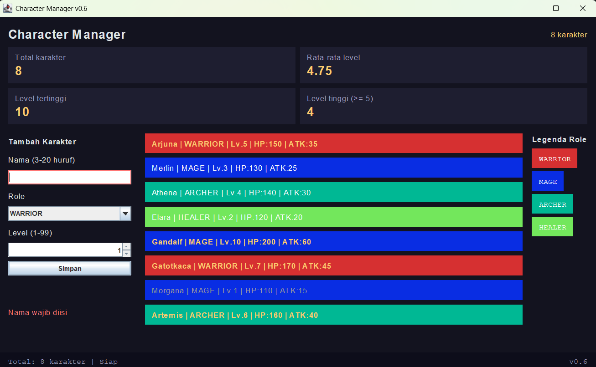
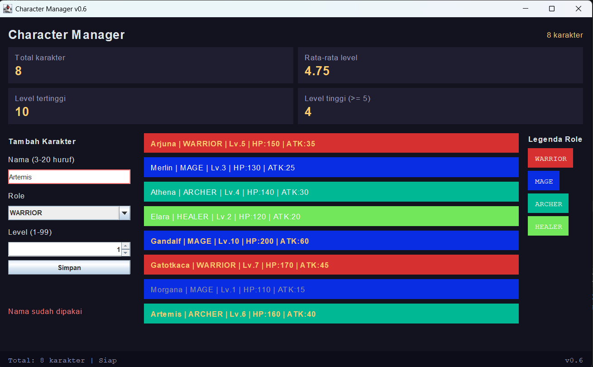
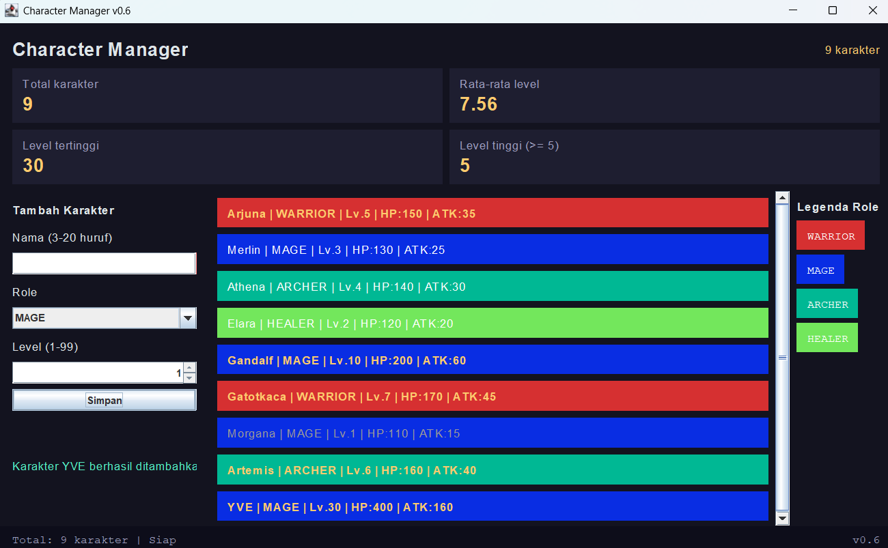

# Character Manager — TP14 (Java Visual SIH-6406)

Pada sprint ini ditambahkan form tambah karakter (`CharacterFormPanel`, package `view`) dengan
validasi dua lapis. View memeriksa bentuk input (kelengkapan, panjang, format) dan memberi
umpan balik langsung, sedangkan Model (`Character` dan `CharacterManager`) menjaga keabsahan
data dengan `IllegalArgumentException` walaupun data tidak datang dari form.
`MainWindow` naik ke v0.6 dan memperbarui daftar lewat `refreshList()`.

## Screenshot

Error nama kosong (pesan merah, border merah, fokus kembali ke field):



Error nama duplikat:



Sukses, kartu baru muncul di daftar:



## Pembagian aturan validasi

| Aturan | Lapisan | Alasan |
|---|---|---|
| Nama wajib diisi (setelah `trim()`) | View | Umpan balik cepat di form; Model juga menolak nama kosong sebagai pengaman |
| Panjang nama 3-20 karakter | View | Aturan bentuk input |
| Nama hanya huruf dan spasi | View | Aturan bentuk input |
| Nama belum dipakai (tidak membedakan huruf besar-kecil) | Model (`isNameTaken`) | Hanya manager yang tahu seluruh daftar |
| Role tidak boleh null, level 1-99 | Model (konstruktor `Character`) | Aturan data; role dibatasi `JComboBox` dan level dibatasi `JSpinner` di View |
| MAGE maksimal level 60 (Mini-Challenge) | Model (konstruktor `Character`) | Tetap masuk akal tanpa jendela, dan `CharacterFormPanel` tidak perlu diubah karena menampilkan `ex.getMessage()` |

## Tabel uji

| No | Input | Hasil diharapkan | Hasil nyata | Lapisan |
|----|-------|------------------|-------------|---------|
| 1 | (nama kosong) | "Nama wajib diisi", border merah, fokus di field | Sesuai: pesan muncul, border merah, kursor di field nama | View: kelengkapan |
| 2 | " " (spasi saja) | Sama dengan kasus 1 (trim) | Sesuai: "Nama wajib diisi" | View: kelengkapan |
| 3 | Ab | "Nama harus 3-20 karakter" | Sesuai | View: panjang |
| 4 | Arjuna123 | "Nama hanya boleh huruf dan spasi" | Sesuai | View: format |
| 5 | arjuna | "Nama sudah dipakai" | Sesuai: huruf kecil tetap dianggap sama dengan "Arjuna" | View memanggil Model (`isNameTaken`) |
| 6 | Bima, MAGE, level 8 | Tersimpan, kartu baru, pesan hijau, form dikosongkan | Sesuai: kartu baru muncul, pesan hijau tampil, form kosong | Sukses |
| 7 | Nama 21 huruf | "Nama harus 3-20 karakter" | Sesuai | View: panjang |
| 8 | " Bima Sakti " | Tersimpan sebagai "Bima Sakti" | Sesuai: spasi tepi dibuang | Sukses setelah `trim()` |
| 9 | Level 500 diketik di spinner | Level di atas 99 tidak boleh masuk | Tidak bisa ditambahkan dengan level di atas 99 dan otomatis reset ke level 1 | Spinner / View |
| 10 | Merlina, MAGE, level 61 | "MAGE tidak boleh di atas level 60" | Sesuai: pesan dari Model tampil tanpa mengubah `CharacterFormPanel` | Model: konstruktor |
| 11 | "Bima  Sakti" (dua spasi) | "Nama tidak boleh memuat spasi berurutan" | Sesuai | View: format |


## Mini-Challenge: MAGE maksimal level 60

Aturan ini diletakkan di konstruktor `Character` (Model) sebagai konstanta bernama
`MAX_MAGE_LEVEL = 60`, lewat method `validate()`. Karena `CharacterFormPanel` sudah menampilkan
`ex.getMessage()` dari `IllegalArgumentException`, pesan "MAGE tidak boleh di atas level 60" otomatis
tampil di form tanpa mengubah satu baris pun di View. Aturan yang sama juga berlaku bila karakter dibuat
langsung dari kode atau dari sumber data lain.

## Dua aturan validasi baru

| Aturan | Lapisan | Alasan |
|---|---|---|
| Nama tidak boleh memuat spasi berurutan | View | Ini aturan tentang bentuk teks yang diketik di layar. Karakter dari sumber lain dengan dua spasi tidak membahayakan integritas data model |
| Maksimal 20 karakter di total daftar (`MAX_CHARACTERS`) | Model (`CharacterManager.addCharacter`) | Ini aturan data yang berlaku untuk karakter dari sumber mana pun, dan hanya manager yang mengetahui ukuran daftar. Dilempar sebagai `IllegalStateException` karena masalahnya ada pada kondisi daftar, bukan pada argumen |

[SESUAIKAN bagian ini bila dua aturan pilihanmu berbeda.]

## Kompromi sementara

Tombol Simpan memakai `addActionListener` berupa lambda minimal (`e -> onSave()`) yang langsung memanggil
logika di dalam View. `CharacterFormPanel` juga memanggil `manager.addCharacter()` langsung, sehingga View
mengenal Model dan sulit diuji tanpa jendela. Keduanya sengaja dibuat sederhana agar fokus sprint ini ada
pada input dan validasi. Pada Pertemuan 9 keduanya diharapkan dipindahkan ke Controller.

## Bukti package `model` bebas dari Swing/AWT

```
git grep -n "javax.swing\|java.awt" -- CharacterManager/src/com/unpri/charactermanager/model
```

Output perintah di atas kosong, artinya package `model` tidak mengimpor `javax.swing` maupun `java.awt`.

## Struktur folder

```
javavisual-tp03-253303621276/
├── README.md
├── .gitignore
├── screenshots/
│   ├── tp14-error-kosong.png
│   ├── tp14-error-duplikat.png
│   └── tp14-sukses.png
└── CharacterManager/
    └── src/
        ├── Main.java
        └── com/unpri/charactermanager/
            ├── model/
            │   ├── CharacterType.java
            │   ├── Character.java
            │   └── CharacterManager.java
            └── view/
                ├── AppTheme.java
                ├── CharacterFormPanel.java
                └── MainWindow.java
```

## Identitas

- Nama: Imanuel Christ P Simatupang
- NIM: 253303621276
- Analisis Bagian D (Google Docs): https://docs.google.com/document/d/1zDcp-gC6GXWXXvPDsevzwnYeCb7I2xF73Q6AanITezE/edit?usp=sharing
