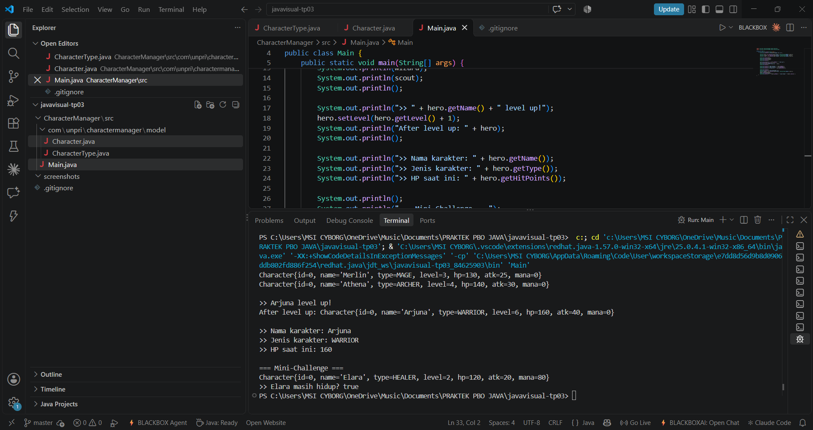

# Character Manager — TP3 (Java Visual SIH-6406)

Proyek ini adalah fondasi model class untuk aplikasi Character Manager
berbasis Java 17. Berisi enum `CharacterType` dan class `Character` dengan
dua constructor, validasi pada setter, serta fitur tambahan `mana` dan
`isAlive()`. Class ini akan menjadi dasar GUI pada sprint berikutnya.

## Output Terminal



## Struktur Folder

```
javavisual-tp03-253303621276/
├── README.md
├── .gitignore
├── screenshots/
│   └── output.png
└── CharacterManager/
    └── src/
        ├── Main.java
        └── com/unpri/charactermanager/model/
            ├── CharacterType.java
            └── Character.java
```

## Identitas

- Nama: Imanuel Christ P Simatupang
- NIM: 253303621276
- Analisis Bagian D (Google Docs): [link menyusul]