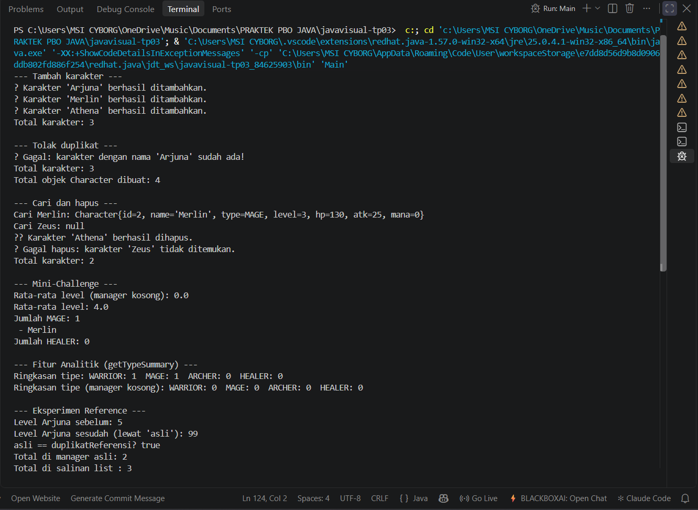

# Character Manager — TP3 (Java Visual SIH-6406)

Proyek ini adalah fondasi model class untuk aplikasi Character Manager
berbasis Java 17. Berisi enum `CharacterType` dan class `Character` dengan
dua constructor, validasi pada setter, serta fitur tambahan `mana` dan
`isAlive()`. Class ini akan menjadi dasar GUI pada sprint berikutnya.

## Output Terminal


## Struktur Folder

```
javavisual-tp03-253303621276/
├── README.md
├── .gitignore
├── screenshots/
│   └── output.png
└── CharacterManager/
    └── src/
        ├── Main.java
        └── com/unpri/charactermanager/model/
            ├── CharacterType.java
            └── Character.java
```

## Identitas

- Nama: Imanuel Christ P Simatupang
- NIM: 253303621276
- Analisis Bagian D (Google Docs): https://docs.google.com/document/d/1TI8xPdEMy4z-I7K7wC-oL94S7rXh3nMTShnTTqvBsds/edit?usp=sharing

# Character Manager — TP3 (Java Visual SIH-6406)

Proyek ini adalah fondasi model class untuk aplikasi Character Manager
berbasis Java 17. Berisi enum `CharacterType` dan class `Character` dengan
dua constructor, validasi pada setter, serta fitur tambahan `mana` dan
`isAlive()`. Class ini akan menjadi dasar GUI pada sprint berikutnya.

## Output Terminal (TP3)


## Identitas

- Nama: Imanuel Christ P Simatupang
- NIM: 253303621276
- Analisis Bagian D TP3 (Google Docs): [link Google Docs TP3 yang sudah ada]

---

## TP5 — Character Manager Sprint #2

Pada sprint ini ditambahkan class `CharacterManager` yang mengelola koleksi
`Character` memakai `ArrayList`, dengan penolakan nama duplikat lewat `equals()`,
`getAllCharacters()` yang mengembalikan salinan (defensive copy), serta counter
`static` untuk jumlah objek yang dibuat.

### Fitur baru

- `equals()` pada `Character` membandingkan nama, sehingga nama duplikat ditolak
- `totalCharacterCreated` (`static`) menghitung jumlah objek `Character` yang dibuat
- `CharacterManager`: `addCharacter()`, `findByName()`, `removeCharacter()`,
  `getTotalCharacters()`, `getAllCharacters()`
- Mini-Challenge: `getAverageLevel()` (mengembalikan 0 jika list kosong) dan `findByType()`
- Fitur mandiri: `getTypeSummary()`

### Screenshot output (CRUD dan eksperimen reference)



Screenshot memperlihatkan nama duplikat ditolak, `getAverageLevel()` pada list kosong
menghasilkan `0.0` tanpa error, serta eksperimen reference: `asli == duplikatReferensi`
bernilai `true`, sedangkan menambah karakter ke salinan list tidak mengubah total
di manager (manager tetap 2, salinan menjadi 3).

### Fitur mandiri (Bagian C): `getTypeSummary()`

`getTypeSummary()` merangkum jumlah karakter untuk setiap tipe (WARRIOR, MAGE,
ARCHER, HEALER) dalam satu `String`, misalnya untuk ditampilkan di GUI pada sprint
berikutnya. Method ini mengembalikan `String`, bukan `characterList` atau salinannya,
karena `String` tidak dapat diubah dari luar. Pemanggil hanya menerima hasil hitungan
dan tidak pernah memegang reference ke list internal, sehingga Encapsulation terjaga
dan perubahan data hanya bisa lewat `addCharacter()` dan `removeCharacter()`. Method
memakai `CharacterType.values()`, sehingga jika kelak ditambah tipe baru seperti
NECROMANCER, method ini otomatis ikut menghitungnya tanpa perlu diubah.

### Struktur folder

```
javavisual-tp03/
├── README.md
├── .gitignore
├── screenshots/
│   ├── output.png
│   └── output-tp5.png
└── CharacterManager/
    └── src/
        ├── Main.java
        └── com/unpri/charactermanager/model/
            ├── CharacterType.java
            ├── Character.java
            └── CharacterManager.java
```

### Analisis Bagian D TP5 (Google Docs)

https://docs.google.com/document/d/1lNYlKdLlfM6yDAO85SyTOmQBv9GevR5dmRCPF70nRhk/edit?usp=sharing